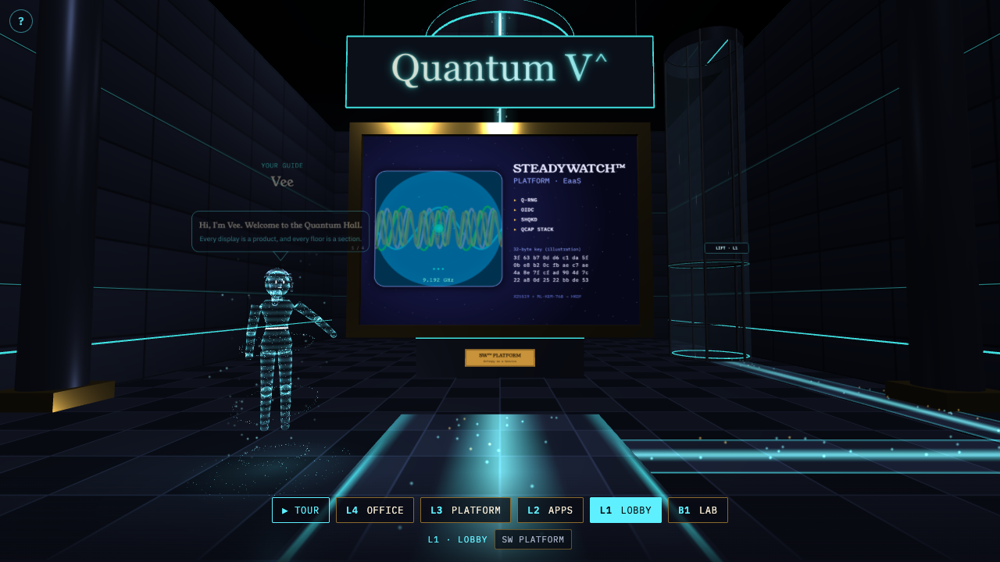
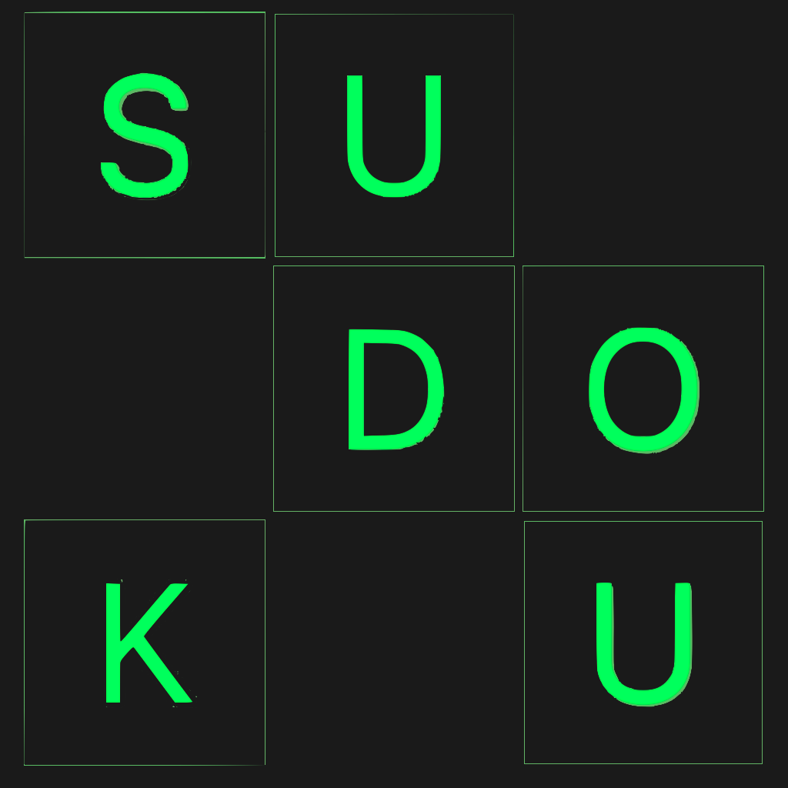
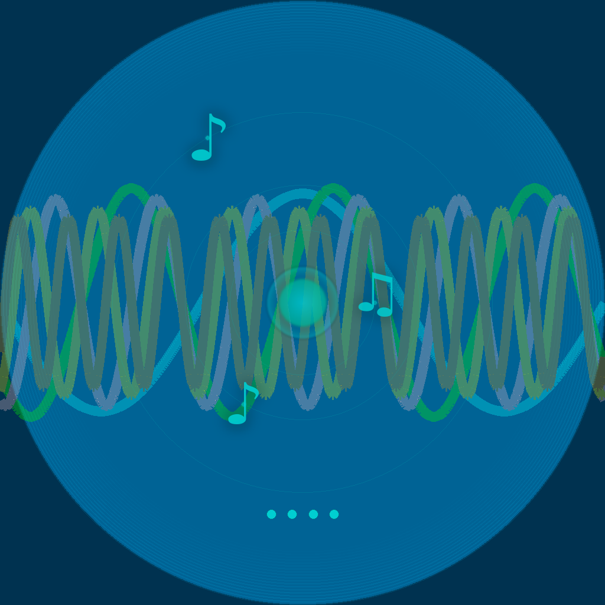
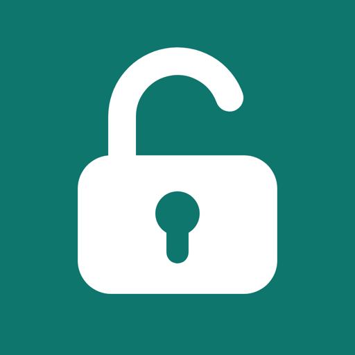
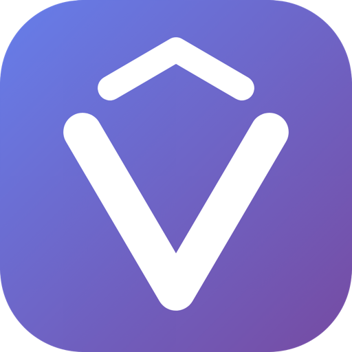

  

  <a href="https://hall.steady-watch.com/"><strong>Walk the gallery →</strong></a> 
  Five floors around an atrium, from the cryostat lab to the builder's office. Walk up to a display and step inside to see the project. Runs in the browser on desktop and mobile.

## Apps

<table>
  <tr>
    <td width="120" align="center" valign="middle"></td>
    <td valign="top">
      <strong>KaizenDoku</strong> 
      Sudoku. With Friends.
        
      KaizenDoku is the Sudoku experience designed for players to enjoy solo, or side-by-side with a friend.
        
      Team up directly in iMessages and solve a Sudoku board together or race against the clock in solo time-attack! Every multiplayer match is fully supported by Apple Game Center, so your wins, best-time, and progress are posted on Game Center leaderboards and backed by Game Center achievements. Share and compare with all your friends!
        
      Prefer a solo challenge? Kudosu tasks you with spotting the duplicate number before time runs out.
        
      KaizenDoku logs your mindful minutes directly to Apple Health, turning your daily Sudoku puzzle solving skill into a measurable wellness practice.
        
      Every multiplayer and time-attack board is generated from IBM Quantum hardware entropy via the Quantum V^ Platform (QES-256).
        
      Free on the App Store. In-app purchases and subscriptions optional for Game Center features.
       
      <a href="https://apps.apple.com/us/app/kaizendoku/id6748037311">Download on the App Store</a> · <a href="https://kaizendoku.com">Website</a>
    </td>
  </tr>
  <tr>
    <td width="120" align="center" valign="middle"></td>
    <td valign="top">
      <strong>STEADYWATCH™ HANDHELD</strong> 
      Harmonic Tuner
        
      A live harmonic tuner and steadiness practice tool for iPhone and Apple Watch. Play or sing, and every harmonic of your note becomes a wave band that stands still when you're in tune.
        
      <strong>HARMONIC BANDS</strong> 
      Each harmonic of your note is a wave band: the bands drift while you're off pitch and stand still in tune.
        
      <strong>ORB NEEDLE</strong> 
      How far flat or sharp you are.
        
      <strong>STEADINESS RING</strong> 
      How steadily you hold the note over a 1, 3 or 8 second window, with a counter that times the hold.
        
      <strong>CHORDS</strong> 
      The notes sounding, the chord they make and the song's key.
        
      <strong>A4 TUNING</strong> 
      Set A4 from 415 to 446 Hz, with the Digital Crown on Apple Watch.
        
      Free on the App Store.
       
      <a href="https://apps.apple.com/us/app/steadywatch-handheld/id6755752518">Download on the App Store</a> · <a href="https://steady-watch.com">Website</a>
    </td>
  </tr>
  <tr>
    <td width="120" align="center" valign="middle"></td>
    <td valign="top">
      <strong>Recluda</strong> 
      Coming soon · iPhone, iPad and Mac
        
      A security key in your device. Sign-ins are approved with Face ID or Touch ID, using a key in the Secure Enclave that never leaves the device, with number matching so a stranger can't trick you into approving theirs. Pushes bring each sign-in to you, VPN logins included. A self-hosted alternative to Cisco Duo: your server, your data, no per-seat fee.
        
      <strong>FACE SCAN APPROVAL</strong> 
      Tap the number the sign-in screen shows, then Face ID or Touch ID.
        
      <strong>PUSH APPROVALS</strong> 
      Each sign-in comes to your phone: no code to type, no QR to scan.
        
      <strong>VPN SIGN-IN</strong> 
      Any VPN that speaks RADIUS: your username, then the push.
        
      <strong>HISTORY</strong> 
      Every sign-in you approved or denied, kept on the device.
        
      <strong>SELF-HOSTED</strong> 
      Your own server, even a Raspberry Pi: you keep your data.
        
      Coming soon to the App Store.
       
      <a href="https://recluda.com">Website</a>
    </td>
  </tr>
</table>

## Platform

<table>
  <tr>
    <td width="120" align="center" valign="middle"></td>
    <td valign="top">
      <strong>Quantum V^ Platform</strong> 
      Entropy as a Service (EaaS)
        
      Quantum-derived randomness as a service, from the Quantum V^ research. Its QRNG API serves bytes from an entropy pool seeded on IBM Quantum hardware, and <strong>QES-256</strong> turns them into 32-byte keys, each traceable to a verifiable IBM Quantum job ID.
        
      <strong>Q-RNG</strong> 
      Quantum random number API on IBM Quantum hardware.
        
      <strong>QES-KX</strong> 
      Hybrid X25519 + ML-KEM-768 (NIST FIPS 203) key exchange via HKDF. The relay never sees the derived key.
        
      <strong>QCAP STACK</strong> 
      IBM <strong>Q</strong>uantum · <strong>C</strong>loudflare · <strong>A</strong>pple Secure Enclave · Raspberry <strong>P</strong>i
        
      <a href="https://quantum-v.nathaniel-a-vazquez.workers.dev/">Website</a> · <a href="https://quantum-v.nathaniel-a-vazquez.workers.dev/qrng">Q-RNG Demo</a> · <a href="https://quantum-v.nathaniel-a-vazquez.workers.dev/qes-rng">QES-256</a> · <a href="https://quantum-v.nathaniel-a-vazquez.workers.dev/status">Live Status</a>
    </td>
  </tr>
</table>
